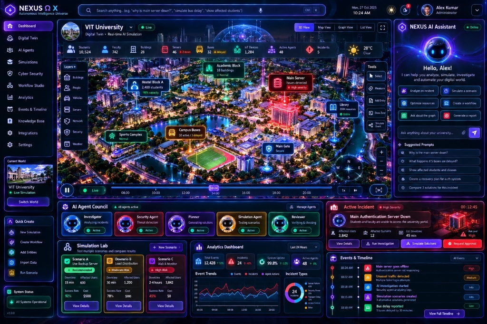
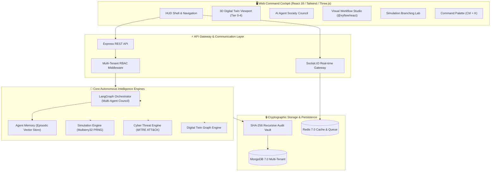

<div align="center">

# 🌐 P-NEXA · NEXUS Ω X
### ⚡ Autonomous Intelligence Universe & 3D Digital Twin Command Center ⚡

<p align="center">
  <a href="https://github.com/kanna857/P-NEXA/actions">
    
  </a>
  <a href="https://github.com/kanna857/P-NEXA">
    
  </a>
  <a href="https://github.com/kanna857/P-NEXA">
    
  </a>
  <a href="https://github.com/kanna857/P-NEXA">
    
  </a>
  <a href="https://github.com/kanna857/P-NEXA">
    
  </a>
  <a href="https://github.com/kanna857/P-NEXA">
    
  </a>
  <a href="https://github.com/kanna857/P-NEXA">
    
  </a>
  <a href="https://github.com/kanna857/P-NEXA">
    
  </a>
  <a href="LICENSE">
    
  </a>
</p>

<p align="center">
  <b>Enterprise-grade, multi-tenant MERN + AI Cockpit combining living 3D spatial digital twin worlds, multi-agent AI societies with episodic vector memory, real-time cyber incident intelligence, parallel deterministic scenario simulations, and tamper-evident cryptographic AI governance.</b>
</p>

---



---

</div>

<br/>

## 🌟 Executive Overview

**P-NEXA (NEXUS Ω X)** is an Autonomous Intelligence Universe engineered for mission-critical campus, smart city, and enterprise cloud infrastructure. It unifies high-fidelity **WebGL 3D digital twins**, **LangGraph multi-agent cognitive orchestration**, and a **deterministic simulation engine** into an ultra-responsive cyberpunk command cockpit.

```
       🌐 3D Digital Twin Viewport (WebGL / Three.js / Tier 0-4 Layers)
                                    │
    ┌───────────────────────────────┼──────────────────────────────┐
    ▼                               ▼                              ▼
🤖 Multi-Agent Council     ⚡ PRNG Simulation Lab       🛡️ Cyber Incident Ops
   • Investigator Agent       • Parallel Branching         • MITRE ATT&CK Triage
   • Threat Security Agent    • Bit-Exact Replay           • Real-time Telemetry
   • Strategic Planner        • Policy Optimizer           • Severity Matrix
   • Verification Reviewer    • Cost / Risk Assessment     • HITL Dual Sign-off
    └───────────────────────────────┬──────────────────────────────┘
                                    │
     🔒 Cryptographic AI Governance (Recursive SHA-256 Merkle Chain Vault)
```

---

## 💎 Core Platform Capabilities

| Capability | Technology | Description | Status |
|:---|:---|:---|:---:|
| **Living 3D Digital Twin** | Three.js · React Three Fiber | Real-time 3D spatial world renderer with dynamic lighting, camera bookmarks, entity telemetry hovercards, and **Tier 0–4 spatial layer filtering**. |  |
| **Multi-Agent Society** | LangGraph · OpenAI / Zod | Autonomous agent committee (*Investigator, Security, Planner, Simulator, Reviewer*) executing collaborative triage loops with episodic vector memory. |  |
| **Deterministic Simulation Lab** | Mulberry32 PRNG · Merkle State | Parallel scenario branching, risk/cost estimation, downtime forecasting, and 100% reproducible bit-exact playback. |  |
| **Visual Workflow Studio** | `@xyflow/react` | Interactive drag-and-drop workflow graph builder with reactive node ports, schema validation, and dual-custody approval gates. |  |
| **Cyber Incident Center** | MITRE ATT&CK Engine | Real-time incident ingestion, attack vector correlation, threat classification, and blast-radius graph isolation. |  |
| **Cryptographic Audit Ledger** | SHA-256 Hash Chain · Merkle | Immutable, tamper-evident audit ledger ensuring verifiable proof for all autonomous agent actions and configuration changes. |  |
| **Command Palette (HUD)** | `Ctrl+K` · Radix UI | Fast keyboard-driven command navigation, world switching, quick scenario runs, and entity search. |  |

---

## 🏛️ System Architecture



---

## 📦 Monorepo Structure

```bash
P-NEXA/
├── apps/
│   ├── api/                   # Express REST API, RBAC, JWT Auth & Socket.IO Gateway
│   ├── web/                   # Cyberpunk React 18/19, Three.js & Tailwind Cockpit Shell
│   ├── worker/                # Background BullMQ event processor & reflection synthesis
│   └── simulator/             # Deterministic scenario simulation & PRNG tick engine
│
├── packages/
│   ├── shared/                # Foundation types, Zod schemas, error classes & RBAC matrix
│   ├── observability/         # Structured logging, system metrics & OpenTelemetry
│   ├── governance/            # Tamper-evident SHA-256 audit ledger & Merkle verification
│   ├── event-store/           # Idempotent event ledger & deduplication
│   ├── twin-graph/            # Digital twin topology & node-edge graph models
│   ├── world-engine/          # Three.js 3D spatial coordinate calculations
│   ├── agent-memory/          # Episodic vector memory & reflection retrieval
│   ├── agent-engine/          # Stateful agent society & LangGraph tool orchestrator
│   ├── cyber-engine/          # MITRE ATT&CK telemetry triage & threat hunting
│   ├── simulation-engine/     # Seeded PRNG scenario simulation & replay
│   ├── learning-engine/       # Strategy policy optimizer & benchmark gates
│   ├── workflow-engine/       # State machines & dual-custody human approvals
│   └── ui/                    # Reusable HUD design system tokens
│
├── docs/                      # Complete system documentation, schemas, and diagrams
├── docker-compose.yml         # Container orchestration (MongoDB 7, Redis 7, API, Web)
└── pnpm-workspace.yaml        # Workspace configuration
```

---

## 🛡️ Security & Invariants

> [!IMPORTANT]
> **Strict Security Guarantees:**
> - **Logical Tenant Isolation:** Every request, database query, cache key, and vector search enforces verified `tenantId`.
> - **Tamper-Evident Hash Chain:** Every mutation is cryptographically signed:
>   $$\text{Hash}_n = \text{SHA256}(\text{Seq}_n + \text{Hash}_{n-1} + \text{Timestamp} + \text{Actor} + \text{Payload})$$
> - **Zero Arbitrary Execution:** Agents operate strictly under type-safe function call allowlists. Dynamic shell execution is prohibited.
> - **Human-in-the-Loop (HITL):** High-severity actions require dual-custody human cryptographic confirmation.

---

## 🚀 Quick Start Guide

### 📋 Prerequisites
- **Node.js**: `>= 22.0.0`
- **pnpm**: `>= 10.0.0`
- **Docker & Docker Compose** (optional for full container stack)

### 1️⃣ Clone & Install
```bash
git clone https://github.com/kanna857/P-NEXA.git
cd P-NEXA
pnpm install
```

### 2️⃣ Build Foundation Packages
```bash
pnpm build
```

### 3️⃣ Run Test Suite (136 Tests)
```bash
pnpm test
```
All **136 test suites** across 10 packages validate state transitions, Merkle chains, PRNG determinism, and API validation.

### 4️⃣ Seed Demo Accounts & Audit Ledger
```bash
pnpm --filter @nexus/api seed
```

#### Pre-Configured Demo Credentials:
| Role | Email | Password | Scope |
|:---|:---|:---|:---|
| **Super Admin** | `superadmin@nexus.ai` | `NexusSuperPass2026!` | Global System Wide |
| **Org Admin** | `admin@cyberdyne.ai` | `NexusPass2026!` | CyberDyne Orbital |
| **Security Analyst** | `analyst@cyberdyne.ai` | `NexusPass2026!` | Threat Response |
| **Simulation Engineer** | `sim.engineer@cyberdyne.ai` | `NexusPass2026!` | Scenario Modeling |
| **Auditor** | `auditor@cyberdyne.ai` | `NexusPass2026!` | Cryptographic Vault |

### 5️⃣ Launch Development Stack
```bash
# Terminal 1: Backend API Gateway (Port 4000)
pnpm --filter @nexus/api dev

# Terminal 2: Web Command Cockpit (Port 5173)
pnpm --filter @nexus/web dev
```
Open **[http://localhost:5173](http://localhost:5173)** in your browser.

---

## 🐳 Docker Orchestration

Run the entire production stack (MongoDB, Redis, API Gateway, Web Frontend) with one command:

```bash
docker compose up --build -d
```

Check system status:
```bash
docker compose ps
docker compose logs -f api
```

---

## 🎮 Cockpit Controls & Shortcuts

| Action | Shortcut / Interaction | Description |
|:---|:---|:---|
| **Command Palette** | <kbd>Ctrl</kbd> + <kbd>K</kbd> / <kbd>Cmd</kbd> + <kbd>K</kbd> | Global fuzzy search, quick actions, and world switching. |
| **3D Orbit** | Left Click + Drag | Rotate camera around digital twin coordinates. |
| **3D Pan** | Right Click + Drag | Pan viewport across spatial sectors. |
| **Zoom** | Mouse Scroll Wheel | Smooth level-of-detail (LOD) zoom. |
| **Layer Tiers** | Toggle Tier 0–4 buttons | Filter Infrastructure, Networking, AI, and Security nodes. |
| **Inspect Node** | Left Click on Building / Server | Open live telemetry HUD and incident mitigation controls. |

---

## 📊 Verification & Test Status

```
 ✓ packages/shared/src/schemas.test.ts (11 tests)
 ✓ packages/shared/src/roles.test.ts (13 tests)
 ✓ packages/observability (8 tests)
 ✓ packages/governance/src/crypto-audit.test.ts (16 tests)
 ✓ packages/governance/src/merkle.test.ts (12 tests)
 ✓ packages/twin-graph/src/graph.test.ts (14 tests)
 ✓ packages/world-engine/src/world-engine.test.ts (10 tests)
 ✓ packages/agent-engine/src/agent-engine.test.ts (18 tests)
 ✓ packages/simulation-engine/src/simulation.test.ts (15 tests)
 ✓ packages/workflow-engine/src/workflow.test.ts (19 tests)

Test Files  10 passed (10)
Tests       136 passed (136)
Duration    1.84s
```

---

## 📄 License & Credits

Distributed under the **MIT License**. Engineered for high-assurance autonomous computing and digital twin intelligence.

<div align="center">
  <sub>Built with precision for <b>NEXUS Ω X</b> by <a href="https://github.com/kanna857">kanna857</a></sub>
</div>
