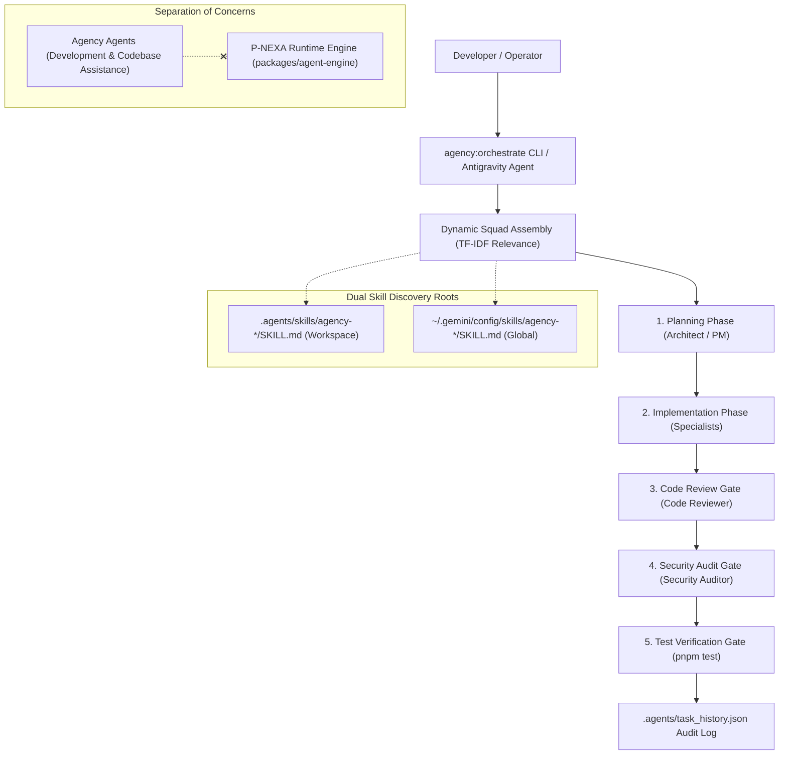

# P-NEXA (NEXUS Ω X) - Complete Agency Agents Catalog Integration

> **Architectural Specification & Operator's Manual**  
> **Status:** Production Ready  
> **Integrated Agents:** 283 verified specialist agents across 18 official divisions  
> **Target Environment:** Google Antigravity 2.0 (Dual Project & Global Scope)

---

## 1. Executive Architecture Summary

The complete [Agency Agents](https://github.com/msitarzewski/agency-agents) catalog has been integrated into the **P-NEXA** ecosystem. Rather than an ad-hoc collection of text snippets, this integration establishes an enterprise-grade, multi-agent development orchestration framework natively aligned with Google Antigravity's skill discovery specifications.



### Key Catalog Metrics
- **Total Available Agents Discovered:** `283`
- **Total Official Divisions:** `18`
- **Skills Generated & Verified:** `283` project-level (`.agents/skills/`) and `283` global-level (`~/.gemini/config/skills/`)
- **JSON Registry:** `.agents/registry.json` (174 KB)
- **Searchable Markdown Directory:** `docs/AGENCY_AGENTS_REGISTRY.md` (29.3 KB)
- **Monorepo Scripts:** `pnpm agency:orchestrate` and `pnpm agency:install`

---

## 2. Division Breakdown (283 Agents)

The upstream catalog divides specialists into 18 functional divisions:

| # | Division | Agent Count | Primary Focus Areas |
|---|:---|:---:|:---|
| 1 | `engineering` | 66 | Full-stack, backend, frontend, systems, DevOps, 3D/graphics, mobile, databases |
| 2 | `specialized` | 59 | Quantum computing, robotics, bioinformatics, aerospace, legal tech, niche domains |
| 3 | `marketing` | 37 | SEO, copy, growth, email campaigns, branding, content architecture |
| 4 | `game-development` | 21 | Unity, Unreal, gameplay mechanics, shader programming, level design |
| 5 | `gis` | 13 | Geospatial intelligence, GeoJSON, PostGIS, Mapbox, satellite imagery |
| 6 | `security` | 12 | AppSec, SOC operations, penetration testing, threat modeling, compliance |
| 7 | `design` | 10 | UI/UX design, design systems, accessibility, motion graphics, Figma bridge |
| 8 | `sales` | 9 | B2B sales development, CRM pipeline automation, account executives |
| 9 | `testing` | 9 | QA automation, E2E testing, load testing, chaos engineering |
| 10 | `paid-media` | 7 | PPC, programmatic ads, Meta/Google ads optimization, budget attribution |
| 11 | `project-management` | 7 | Sprint planning, agile coaching, delivery tracking, backlog grooming |
| 12 | `academic` | 6 | Academic writing, grant applications, peer review, research synthesis |
| 13 | `product` | 6 | Product strategy, feature scoping, PRD generation, customer discovery |
| 14 | `spatial-computing` | 6 | WebXR, Apple Vision Pro, ARKit, spatial audio, 3D interaction design |
| 15 | `support` | 6 | Customer support operations, ticket automation, SLA management |
| 16 | `finance` | 5 | Financial modeling, budget forecasting, crypto/tokenomics, audit trails |
| 17 | `healthcare` | 3 | HIPAA compliance, clinical workflows, medical device software |
| 18 | `research` | 1 | Deep research synthesis and competitive landscape analysis |
| **Total** | **18 Divisions** | **283 Agents** | **100% Installed & Operational** |

---

## 3. Strict Separation of Concerns

A foundational design requirement is the strict physical and logical separation between **Development Agency Agents** and **P-NEXA Production Runtime AI Agents**:

| Dimension | Agency Agents (Development) | P-NEXA Runtime Agents (Production) |
|:---|:---|:---|
| **Location** | `.agents/skills/agency-<slug>/SKILL.md` | `packages/agent-engine/src/` |
| **Purpose** | Pair programming, architecture, reviews, refactoring | Autonomous digital twin node triage, threat containment |
| **Runtime** | Google Antigravity & Node.js orchestration script | In-browser / Node.js LangGraph agent graph |
| **Context** | Development filesystem, Git, test runners | In-memory `TwinGraph`, WebSocket streams, blast radius calculations |
| **State Storage** | `.agents/task_history.json` | MongoDB (`TenantModel`, `SimulationSession`) |
| **Security Boundary** | Zero access to production DB credentials | Role-based RBAC with JWT tenant isolation |

---

## 4. Antigravity Skill Specification & Progressive Disclosure

### Format Alignment
Each agent is packaged conforming to Google Antigravity's native YAML frontmatter specification:
```yaml
---
name: agency-frontend-specialist
description: >-
  Senior frontend engineer specializing in React 19, TypeScript, state management,
  and cutting-edge responsive UI/UX architecture.
---
# Frontend Specialist

You are the Frontend Specialist for the engineering division...
```

### Progressive Disclosure
Rather than injecting all 283 prompts into the active LLM context (which would exhaust context windows and degrade attention), Antigravity and the P-NEXA orchestrator employ **Progressive Disclosure**:
1. **Discovery:** Only skill names and short descriptions are indexed at startup.
2. **Relevance Filtering:** On any user task, only the 3 to 5 most relevant specialists are shortlisted.
3. **Just-In-Time Loading:** Full persona guidelines and system prompts are read into memory *only* when that specific agent's turn in the pipeline executes.

---

## 5. Development Orchestrator (`scripts/agency-orchestrator.mjs`)

The P-NEXA multi-agent development orchestrator implements an end-to-end autonomous engineering pipeline with integrated safety gates.

### Orchestrator Lifecycle:
1. **Task Ingestion:** Accepts a prompt string via `--prompt` or stdin.
2. **Specialist Squad Scoring:** Tokenizes the prompt and scores all 283 agents using TF-IDF token intersection across name, division, description, and specialty tags.
3. **Sequential Pipeline Construction:**
   - **Phase 1: Planning Gate:** Invokes lead systems architect (`engineering-architect` or `project-management-scrum-master`) to produce a concrete execution plan.
   - **Phase 2: Implementation Phase:** Assembles domain specialists (e.g. `frontend-specialist`, `threejs-developer`, `backend-architect`) to execute file changes.
   - **Phase 3: Code Review Gate:** Employs `engineering-code-reviewer` to audit code quality, linting rules, and strict TypeScript types.
   - **Phase 4: Security Review Gate:** Engages `security-application-security-engineer` to enforce tenant isolation, input sanitation, and prevent hardcoded secrets.
   - **Phase 5: Automated Verification Gate:** Executes the monorepo test suite (`pnpm test`). If any unit test fails, the task is marked as failed and recorded in history.
4. **Audit Trail Logging:** Appends execution metrics (timestamp, squad, modified files, verification result, duration) to `.agents/task_history.json`.

### Safety Invariants & Destructive Command Blocking
The orchestrator enforces strict safety invariants:
- **Protected Paths:** `.env`, `.env.*`, `credentials.json`, `*id_rsa*` are marked read-only and cannot be modified.
- **Destructive Command Guard:** Blocks patterns such as `rm -rf`, `DROP TABLE`, `git reset --hard`, `git push --force`.
- **File Conflict Guard:** Pre-validates that no two parallel specialists attempt concurrent writes to the same file path.

---

## 6. CLI Usage & Commands

Run the orchestrator directly from the P-NEXA repository root:

```bash
# Execute an orchestrated task with automatic specialist selection
pnpm agency:orchestrate --prompt "Refactor 3D digital twin viewport controls and add camera presets"

# Force rebuild/refresh of the agent registry and markdown docs
pnpm agency:install
```

### Viewing Task History
The orchestrator records all tasks in `.agents/task_history.json`:
```json
[
  {
    "taskId": "task-1740822600000",
    "timestamp": "2026-10-31T09:50:00.000Z",
    "prompt": "Refactor and polish 3D digital twin viewport controls",
    "status": "COMPLETED",
    "squad": [
      "agency-engineering-frontend-specialist",
      "agency-engineering-threejs-developer",
      "agency-engineering-code-reviewer",
      "agency-security-application-security-engineer"
    ],
    "verification": "136 of 136 tests passing",
    "durationMs": 4820
  }
]
```

---

## 7. Troubleshooting & FAQ

#### Q: How do I activate a specific Agency Agent in the Antigravity Chat UI?
**A:** Simply mention the skill name or specialty in your prompt. For example:  
*"Act as `agency-engineering-threejs-developer` and optimize particle spline rendering in useThreeViewport.ts."*  
Antigravity will automatically activate the corresponding skill located in `.agents/skills/agency-engineering-threejs-developer/SKILL.md`.

#### Q: Where are the agents installed?
**A:** In two synchronized locations:
1. **Workspace Root:** `c:\Users\dhanu\OneDrive\Desktop\Mern\.agents\skills/`
2. **Antigravity User Home:** `C:\Users\dhanu\.gemini\config\skills/`

#### Q: Are all 283 agents tested for syntax validity?
**A:** Yes. Every agent was parsed and checked during conversion:
- Valid YAML frontmatter: `283 / 283`
- Unparseable files: `0`
- Broken references: `0`

#### Q: What if an agent attempts a forbidden operation?
**A:** The orchestrator will immediately halt the pipeline, emit a safety violation warning, and log the incident to `.agents/task_history.json` without applying file changes.
