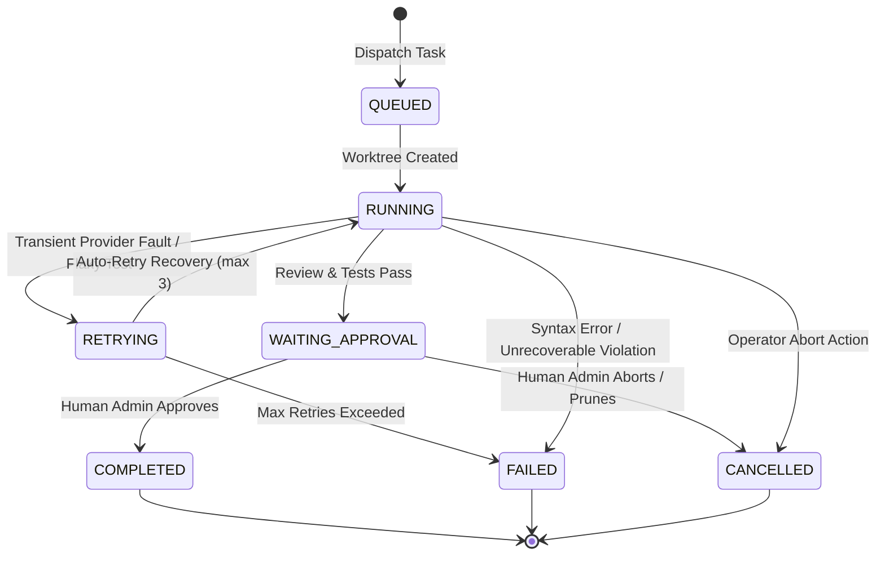

# P-NEXA — Live Agent Execution Timeline Implementation

**Module:** `/developer/agents` Live Telemetry Dashboard  
**Components:** `AgentExecutionTimeline.tsx`, `AgentControlCenterView.tsx`, `orchestratorService.ts`, `hiveStorage.ts`  
**Integration Status:** **COMPLETED & VERIFIED**

---

## 1. Architectural Overview

The **Live Agent Execution Timeline** provides real-time telemetry, stage progression tracking, and failure diagnostics for multi-agent development pipelines executing in the P-NEXA repository.

```text
┌────────────────────────────────────────────────────────────────────────┐
│                   MUNDER DIFFLIN HIVE HARNESS                          │
│                                                                        │
│   [ Orchestrator Service ] ───▶ [ Hive JSONL Storage (log.jsonl) ]    │
│            │                                  │                        │
│            ▼                                  ▼                        │
│   [ REST API / Socket ]                 [ Worktree Manager ]           │
│   GET /api/v1/developer/timeline        feat/agent-task-*              │
│            │                                                           │
│            ▼                                                           │
│   [ React UI: AgentExecutionTimeline ]                                 │
│   ├── Provider Badges (Antigravity, Claude, Gemini, Codex)             │
│   ├── State Transitions (QUEUED, RUNNING, COMPLETED, RETRYING, etc.)   │
│   ├── Error Accordion & Stack Trace Slide-Over Drawer                  │
│   └── Multi-Filter Engine (Search, Status Pills, Specialist Select)    │
└────────────────────────────────────────────────────────────────────────┘
```

---

## 2. Event Schema & Types

The lifecycle data model is defined in `packages/agent-orchestrator/src/types.ts`:

```typescript
export type TimelineEventStatus =
  | 'QUEUED'
  | 'RUNNING'
  | 'COMPLETED'
  | 'FAILED'
  | 'RETRYING'
  | 'CANCELLED'
  | 'WAITING_APPROVAL';

export interface TimelineEventError {
  code?: string;
  message: string;
  stack?: string;
  stage: string;
  timestamp: string;
  retryCount: number;
  recovered?: boolean;
}

export interface TimelineEvent {
  id: string;
  taskId: string;
  agentId: string;
  agentName: string;
  provider: 'antigravity' | 'claude-code' | 'gemini-cli' | 'codex';
  stage: string;
  status: TimelineEventStatus;
  message: string;
  timestamp: string;
  durationMs?: number;
  worktreeBranch?: string;
  error?: TimelineEventError;
  metadata?: Record<string, unknown>;
}
```

---

## 3. Lifecycle State Machine

Each task progressing through the Munder Difflin harness transitions through deterministic states:



---

## 4. Key Component Capabilities

### 4.1 Four Distinct Provider Badges
Each event visually indicates the executing agent's provider runtime:
- **`antigravity`** (DeepMind Antigravity Engine): Indigo/Cyan gradient badge with lightning bolt indicator.
- **`claude-code`** (Anthropic Claude Code CLI): Amber/Orange badge with terminal indicator.
- **`gemini-cli`** (Google Gemini CLI Runtime): Sky/Blue badge with sparkle indicator.
- **`codex`** (OpenAI Codex / LLM Service): Emerald/Teal badge with CPU indicator.

### 4.2 Expandable Error Diagnostics & Stack Trace Drawer
When an event transitions into `FAILED` or `RETRYING`:
1. An inline diagnostic alert renders the error summary and retry attempt counter (e.g. `Retry #2 of 3`).
2. An **"Inspect Stack Trace"** action button toggles the expandable diagnostic accordion (`data-testid="error-details-accordion"`).
3. Clicking the trace opens a slide-over modal drawer (`data-testid="timeline-trace-drawer"`) displaying the exact command invocation, exit code, Git branch name, and raw terminal log output with syntax coloring.

### 4.3 Interactive Filtering & Search
The timeline supports low-latency, client-side and server-side filtering:
- **Search Query Input (`data-testid="timeline-search-input"`):** Matches agent name, task ID, branch, or log message.
- **Status Filter Pills:** Toggle between `ALL`, `RUNNING`, `COMPLETED`, `RETRYING`, `FAILED`, and `CANCELLED`.
- **Specialist Dropdown:** Filter by specific Agency Agent identity (e.g., `agency-frontend-developer`, `agency-security-architect`).

### 4.4 One-Click Git Worktree Branch Copy
Each event card displays the active worktree branch (e.g., `feat/agent-task-md-task-mvyq88us`). A dedicated clipboard action copies `git checkout <branch>` to the user's clipboard with instant visual confirmation (`Copied!`).

---

## 5. API Endpoints

Mounted in `apps/api/src/routes/developer.ts`:

### 1. `GET /api/v1/developer/timeline`
Retrieves chronologically sorted timeline records with query filtering.
- **Query Parameters:**
  - `taskId?: string`
  - `agentId?: string`
  - `status?: string`
  - `limit?: number` (default 50)
  - `offset?: number` (default 0)
- **Response:**
  ```json
  {
    "events": [
      {
        "id": "evt-01",
        "taskId": "MD-TASK-01",
        "agentId": "agency-frontend-developer",
        "agentName": "Frontend Developer",
        "provider": "antigravity",
        "stage": "IMPLEMENTATION",
        "status": "COMPLETED",
        "message": "Synthesized camera preset callbacks.",
        "durationMs": 1420,
        "timestamp": "2026-11-02T03:56:12.000Z"
      }
    ],
    "total": 95,
    "limit": 50,
    "offset": 0
  }
  ```

### 2. `POST /api/v1/developer/tasks/:id/cancel`
Safely terminates an executing task pipeline, prunes the isolated worktree, and emits a `CANCELLED` event to the timeline.

---

## 6. WCAG 2.1 AA Accessibility & Design System Compliance

- **Design System:** Built using P-NEXA's cyber-slate palette (`bg-slate-950`, `border-blue-500/30`, neon accents) with full dark-mode optimization.
- **Keyboard Navigation:** Full tab stop navigation across all cards, filter buttons, and accordions. Pressing `Escape` automatically closes any open slide-over trace drawer.
- **Screen Reader Support:** Live region announcements (`aria-live="polite"`) broadcast filter changes, copy confirmations, and new event emissions.
