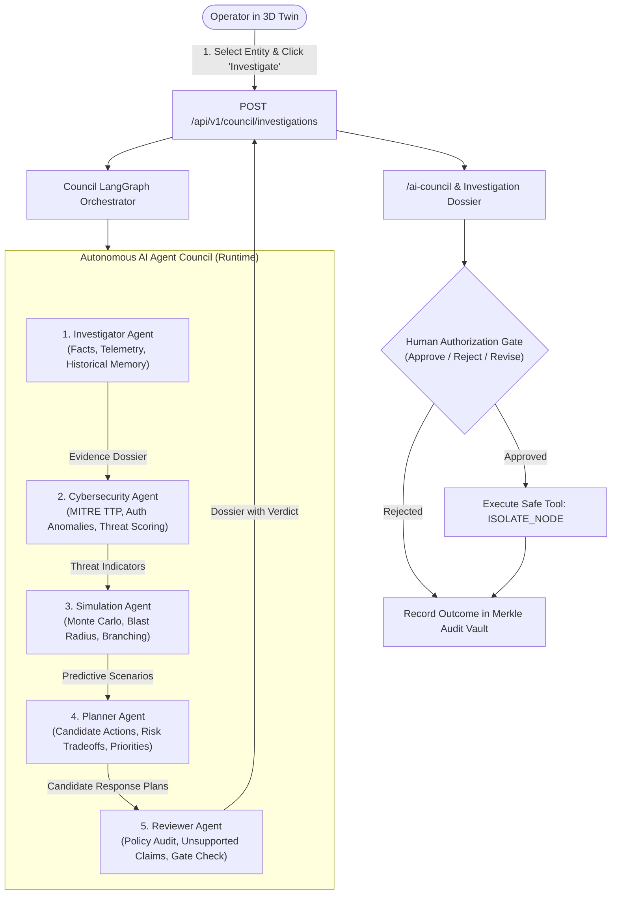

# P-NEXA (NEXUS Ω X) — Phase 4 Architecture Audit & Reuse Plan
**Autonomous AI Agent Council + Digital Twin Intelligence**

**Audit Date:** November 2, 2026  
**Branch:** `feat/phase4-autonomous-ai-council`  
**Base Commit:** `11f2929` (Phase 3 Verified HEAD)  
**Architect:** Principal Agentic AI Architect & Digital Twin Systems Engineer

---

## 1. Executive Summary

Phase 4 elevates P-NEXA from an interactive 3D digital twin and multi-agent development environment into an operational **autonomous AI-assisted incident investigation and decision-support platform**.

This audit inspects all 15 packages and applications across the existing P-NEXA repository to identify existing components, partial implementations, and mock layers. In accordance with master directives, **existing infrastructure will be reused and enhanced rather than replaced or duplicated**.

### Critical Distinction: Development vs. Runtime Agents

| Dimension | Development Agents (Phase 3) | Runtime Agents (Phase 4) |
| :--- | :--- | :--- |
| **Domain** | Repository engineering, testing, PR generation | Operational digital twin incident investigation |
| **Framework** | Agency Agents (283 specialists) + Munder Difflin Hive | Autonomous AI Agent Council (5 cooperating specialists) |
| **Execution Sandbox** | Isolated Git worktrees (`integrations/munder-difflin/hive/worktrees`) | In-memory LangGraph state machine & API gateway |
| **Control UI** | `/developer/agents` (Munder Difflin Control Center) | `/ai-council` (AI Council Command Center) & 3D Viewport |
| **Target User** | Platform Engineers, DevOps, Systems Architects | SOC Analysts, Security Commanders, Facility Directors |

---

## 2. Comprehensive Repository Inventory & Reuse Matrix

| Subsystem / Package | Location | Existing Capabilities | Phase 4 Gap / Mock Status | Reuse & Enhancement Strategy |
| :--- | :--- | :--- | :--- | :--- |
| **Agent Engine** | `packages/agent-engine` | `AgentStateGraph`, checkpointer, approval queue, tool execution sandbox | Personas geared toward general society; missing Phase 4 5-agent council structure | Extend `types.ts` & build `CouncilOrchestrator` implementing the 5 runtime agents with typed inputs/outputs. |
| **Agent Memory** | `packages/agent-memory` | Vector memory, cosine similarity, generative reflection, temporal decay | Isolated to memory unit tests; not persisted per investigation | Connect to runtime council for historical incident correlation, prior recommendations, and audit provenance. |
| **Cyber Engine** | `packages/cyber-engine` | Telemetry normalizer, MITRE ATT&CK correlation, IoC threat intel | Standalone module; not plugged into runtime council events | Ingest into Cybersecurity Agent for failed-login analysis, access pattern anomaly detection, and risk scoring. |
| **Simulation Engine** | `packages/simulation-engine` | Deterministic PRNG, Monte Carlo, scenario branching, SHA-256 state hashing | Standalone module; not executed during client investigation modal | Simulation Agent directly invokes scenario engine for predictive blast radius and dependency failure modeling. |
| **Governance** | `packages/governance` | Merkle vault, SHA-256 chained audit logs, dual-custody approval | Verified unit tests; client modal used localized utility | Formalize backend audit logging: every investigation, review verdict, approval, and rejection records an immutable block. |
| **Twin Graph** | `packages/twin-graph` | `TwinNode`, `TwinEdge`, BFS blast radius, shortest path | Used in digital twin and viewport | Supply live graph topology to Investigator and Simulation agents for dependency propagation. |
| **World Engine** | `packages/world-engine` | Multi-tier seeds (`school`, `office`, `defense`), building layouts, network tiers | Static seed world generation | Provide entity metadata, tier classification, and environmental baselines to runtime agents. |
| **Workflow Engine** | `packages/workflow-engine` | NL generator, state machine execution | Generic workflows | Candidate response plans synthesized by Planner agent map to workflow engine action templates. |
| **Event Store** | `packages/event-store` | Append-only event store, stream projections | Standalone module | Store atomic investigation lifecycle events (`InvestigationCreated`, `EvidenceCollected`, etc.). |
| **Simulator App** | `apps/simulator` | Monte Carlo worker service | Standalone worker | Can be triggered by Simulation Agent for computationally heavy distributed simulations. |
| **Worker App** | `apps/worker` | BullMQ telemetry ingestion worker | Telemetry queue | Ingests streaming telemetry for live anomaly detection. |
| **Express API** | `apps/api` | Auth, tenants, worlds, incidents, scenarios, developer routes | Missing `/api/v1/council/*` routes | Implement complete versioned `council.ts` router with server-side RBAC, validation, and cancel/approve gates. |
| **Web Frontend** | `apps/web` | Three.js WebGL digital twin, entity inspector, timeline, developer dashboard | Client-side modal had simulated timeouts; missing `/ai-council` workspace | Add `/ai-council` Command Center; connect "Investigate with AI Council" to real backend API with live streaming. |

---

## 3. The Five Runtime Council Agents Specification

### 3.1 Detailed Agent Responsibilities

1. **Investigator Agent (`INVESTIGATOR`)**:
   - Queries `@nexus/twin-graph` and `@nexus/world-engine` for target entity telemetry (CPU, memory, ingress/egress, status).
   - Retrieves historical incident memories via `@nexus/agent-memory`.
   - Distinguishes **observed empirical facts** from **hypotheses**.
   - Outputs structured `InvestigationEvidence`.

2. **Cybersecurity Agent (`CYBERSECURITY`)**:
   - Ingests telemetry into `@nexus/cyber-engine`.
   - Analyzes authentication patterns, failed logins, and anomalous network connections.
   - Correlates with MITRE ATT&CK techniques (e.g. T1486, T1021, T1078).
   - Computes an explainable risk score (0–100) and severity rating (`LOW` | `MEDIUM` | `HIGH` | `CRITICAL`).
   - Recommends defensive postures without performing unauthorized destructive modifications.

3. **Simulation Agent (`SIMULATION`)**:
   - Interfaces directly with `@nexus/simulation-engine`.
   - Executes counterfactual what-if scenarios (e.g., server outage, network congestion, credential exfiltration).
   - Models dependency failure propagation across the twin graph.
   - Evaluates baseline vs. intervention scenarios (quarantine vs. rate limit vs. unmitigated spread).
   - Clearly flags all output as **simulated projections**, never as observed reality.

4. **Planner Agent (`PLANNER`)**:
   - Synthesizes findings from Investigator, Cybersecurity, and Simulation agents.
   - Generates prioritized response plan options (e.g., `ISOLATE_NODE`, `SEVER_EDGE`, `RATE_LIMIT_TRAFFIC`, `ROLLBACK_CONFIG`).
   - Quantifies risk reduction percentage and estimated operational downtime.
   - Outlines prerequisites, required dual-custody sign-offs, and rollback steps.

5. **Reviewer Agent (`REVIEWER`)**:
   - Audits all proposed actions against `@nexus/governance` security policies.
   - Detects hallucinated or unsupported claims by cross-referencing evidence references.
   - Flags policy contradictions or excessive blast radius risks.
   - Issues a formal verdict: `APPROVED_FOR_PRESENTATION`, `REVISION_REQUIRED`, or `REJECTED`.
   - **Crucial Rule:** The Reviewer validates recommendations for human review, but can **never bypass the human authorization requirement**.

---

## 4. Phase 4 Implementation Plan & Milestones

1. **Package Enhancement (`packages/agent-engine`):**
   - Add `councilTypes.ts` with comprehensive typed schemas for all 5 agents, investigation context, evidence, and dossiers.
   - Implement `councilOrchestrator.ts` using the state graph engine with bounded retries, timeouts, cancellation tokens, and fallback mechanisms.
2. **Backend API (`apps/api`):**
   - Create `apps/api/src/routes/council.ts` implementing all 7 REST endpoints with RBAC middleware, tenant scoping, validation, and real execution.
   - Mount router in `apps/api/src/app.ts`.
3. **Digital Twin Integration (`apps/web`):**
   - Update `DigitalTwinViewport.tsx` so "Investigate Incident with Agent Council" initiates a real backend investigation via the API and preserves viewport controls.
4. **AI Council Command Center (`/ai-council`):**
   - Create `apps/web/src/components/AICouncilCommandCenterView.tsx` with Overview, Live Timeline, Evidence Explorer, Dossier, and Human Approval Panel.
   - Register route in `App.tsx` and sidebar navigation.
5. **Predictive Simulation & Cyber Integration:**
   - Wire `@nexus/simulation-engine` and `@nexus/cyber-engine` into the runtime council nodes.
6. **Governance & Audit Trail:**
   - Cryptographically sign each investigation outcome and write to `@nexus/governance` Merkle audit ledger.
7. **Verification & Testing:**
   - Unit tests in `packages/agent-engine` and `apps/api`.
   - E2E browser verification in Playwright.
   - Produce all 7 required Phase 4 documentation deliverables.

