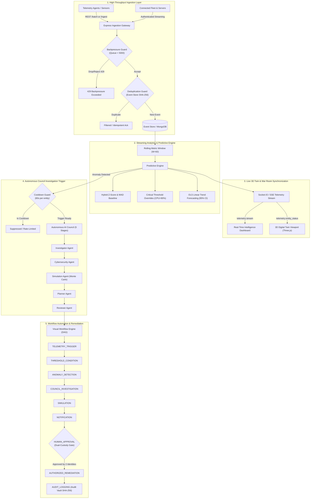

# P-NEXA (NEXUS Ω X) — Phase 5 System Architecture
## Real-Time Telemetry Pipeline, Predictive Intelligence & Autonomous Workflow Automation

### 1. Executive Architecture Overview

Phase 5 elevates P-NEXA from an episodic investigation and digital twin platform into a continuous, real-time autonomous operational plane. The architecture connects live edge/server/IoT telemetry to the 3D Digital Twin, runs sub-millisecond predictive statistical modeling to detect anomalies before catastrophic failure, automatically convenes the AI Agent Council with strict false-positive suppression, and triggers visual directed acyclic graph (DAG) workflow remediations safeguarded by dual-custody human cryptographic gates.

---

### 2. Core Subsystems

#### 2.1 Ingestion & Backpressure Management
- **Endpoint Structure:** REST endpoints at `/api/v1/telemetry/ingest`, `/api/v1/telemetry/batch`, and `/api/v1/telemetry/stream` (Server-Sent Events).
- **Backpressure Protection:** Ingestion buffers enforce an upper bound of 5,000 pending items. When load surges beyond hardware processing capabilities, an HTTP 429 response is returned to preserve cluster stability.
- **Tenant Isolation:** Every event is cryptographically and logically bound to a validated `tenantId`. Telemetry data is never mixed across organizational boundaries.

#### 2.2 Predictive Intelligence Engine
- **Algorithmic Foundation:** Dual statistical baseline combining rolling Exponential Moving Average (EMA, $\alpha = 0.2$), standard deviation ($\sigma$), Median Absolute Deviation (MAD), and critical ceiling safety overrides.
- **Forecast Engine:** Ordinary Least Squares (OLS) regression over historical windows producing projected values with calibrated $95\%$ confidence bounds ($\pm 1.96 \cdot \text{SE}$).
- **False-Positive Suppression:** Temporal debounce windows (default 60 seconds per entity) prevent alert storms and duplicate investigations during ongoing incidents.

#### 2.3 Visual Directed Acyclic Graph (DAG) Automation
- **9 Standard Node Types:**
  1. `TELEMETRY_TRIGGER`: Continuous threshold monitoring.
  2. `THRESHOLD_CONDITION`: Value comparison logic.
  3. `ANOMALY_DETECTION`: Statistical deviation filter.
  4. `COUNCIL_INVESTIGATION`: Multi-agent automated triaging.
  5. `SIMULATION`: Blast-radius counterfactual evaluation.
  6. `NOTIFICATION`: Push notifications via WebSockets.
  7. `HUMAN_APPROVAL`: Dual-custody cryptographic sign-off.
  8. `AUTHORIZED_REMEDIATION`: Isolation, rate-limiting, and traffic severance.
  9. `AUDIT_LOGGING`: Tamper-evident merkle ledger storage.
- **Cycle Prevention:** DFS-based graph traversal validates $O(V + E)$ acyclicity prior to playbook activation, strictly rejecting cyclic deadlocks.

---

### 3. Demo Mode vs. Connected Mode Isolation
To guarantee complete operational safety, P-NEXA supports strict mode segregation:
- **Connected Mode:** Bound to real production agent feeds, physical sensors, and verified network infrastructure. All updates require authentic bearer JWT tokens.
- **Demo Mode:** Uses synthetic simulation generators. All demo data is marked with `mode: 'demo'`, clearly watermarked in the user interface, and isolated from production telemetry tables.
