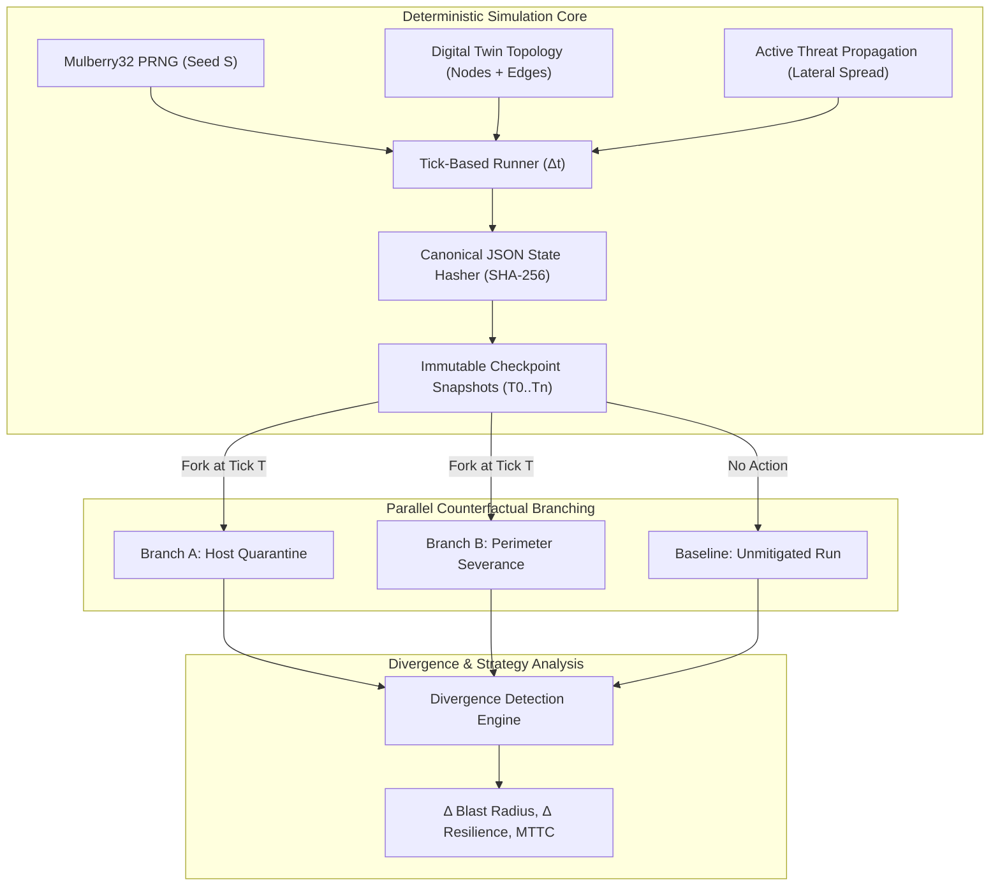

# NEXUS OMEGA X — Phase 5: Parallel Scenario Simulation & Deterministic Replay Report

> [!NOTE]
> **Status:** ✅ 100% COMPLETE  
> **Automated Test Results:** 89 / 89 tests passing across 13 test suites (14s)  
> **Monorepo Build:** 17 / 17 packages and applications cleanly built with 0 errors.

---

## 1. Executive Summary

Phase 5 delivers the deterministic simulation and counterfactual scenario evaluation subsystem for **NEXUS OMEGA X**. It empowers security teams and autonomous agent societies to run digital twin scenarios forward in discrete ticks, simulate active threat actor lateral movement, branch parallel "what-if" timelines from arbitrary checkpoints, test counterfactual interventions (quarantine isolation, edge severance, vulnerability patching), and mathematically prove 100% bit-exact replay reproducibility via canonical SHA-256 state hashes.

---

## 2. Core Components Implemented

### 2.1 Deterministic Pseudo-Random Number Generator (`packages/simulation-engine/src/prng.ts`)
- **Algorithm**: 32-bit Mulberry32 generator with period $2^{32}$.
- **Features**: Float generation `next()`, bounded integer generation `nextInt(min, max)`, probabilistic boolean `nextBoolean(prob)`, array sampling `pickOne(items)`, Fisher-Yates array shuffling `shuffle(items)`, and deterministic state forking `fork(offset)`.
- **Reproducibility**: Guarantees identical execution sequences regardless of OS, runtime, or CPU architecture.

### 2.2 Canonical State Hashing (`packages/simulation-engine/src/state-hash.ts`)
- Uses `@nexus/governance` canonical JSON serialization (`canonicalJsonStringify`) and Node.js `crypto` SHA-256 (`computeSha256`).
- Deterministically sorts nodes, edges, threats, and aggregate metrics prior to hashing, guaranteeing bit-exact state hashes invariant to object property ordering or in-memory references.

### 2.3 Tick-Based Scenario Simulation Engine (`packages/simulation-engine/src/scenario-engine.ts`)
- **State Model**: `SimulationScenario`, `ScenarioSnapshot`, `ActiveThreat`, `SimulationAction`.
- **Threat Lateral Movement**: Deterministic propagation across unsevered network links, adjusting spread probability based on target vulnerabilities (+20%) and link encryption (-15%).
- **Remediation Actions**: Real-time evaluation of `ISOLATE_NODE`, `SEVER_EDGE`, `RESTORE_NODE`, `RESTORE_EDGE`, `APPLY_PATCH`, and `THREAT_INJECT`.
- **System Resilience Metric**:
  $$\text{Resilience} = \max\left(0, 100 - \left(\frac{\text{Compromised}}{\text{Total}} \times 60\right) - \left(\frac{\text{Isolated}}{\text{Total}} \times 20\right) - (\text{ActiveThreats} \times 10)\right)$$
- **Bit-Exact Replay Verification**: `verifyReplay()` resets to initial conditions with identical seed and verifies snapshot hashes tick-by-tick against historical trajectory.

### 2.4 Parallel Branching & Divergence Engine (`packages/simulation-engine/src/branching.ts`)
- **Branching**: Forks a scenario from tick $T$, preserving full historical provenance while scheduling alternate counterfactual actions for future ticks.
- **Divergence Detection**: Compares parent and child scenarios tick-by-tick to identify the exact `divergenceTick`, calculating blast radius delta ($\Delta B$), resilience delta ($\Delta R$), and containment achievement delta.

### 2.5 Simulator Service (`apps/simulator/src/index.ts`)
- **Monte Carlo Batch Runner**: Runs $N$ iterations across prime-spaced seeds to produce statistical probability distributions of containment rate, mean ticks to containment (MTTC), and mean resilience.
- **Counterfactual Strategy Evaluator**: Evaluates multiple candidate containment strategies concurrently against an unmitigated baseline, automatically ranking them by resilience and blast radius reduction.

### 2.6 REST API & Real-Time Sync (`apps/api/src/routes/scenarios.ts`)
Mounted at `/api/v1/scenarios` with RBAC permissions (`SIM_READ`, `SIM_EXECUTE`, `SIM_BRANCH`):
- `POST /api/v1/scenarios`: Initialize simulation scenario from a digital twin world.
- `GET /api/v1/scenarios`: List tenant scenarios.
- `GET /api/v1/scenarios/:id`: Retrieve scenario state and snapshot history.
- `POST /api/v1/scenarios/:id/tick`: Advance simulation by $N$ ticks with Socket.IO room broadcast.
- `POST /api/v1/scenarios/:id/run`: Run simulation forward to target tick or completion.
- `POST /api/v1/scenarios/:id/actions`: Schedule intervention action.
- `POST /api/v1/scenarios/:id/branch`: Create counterfactual branch at tick $T$.
- `GET /api/v1/scenarios/:id/replay`: Execute bit-exact verification and return cryptographic match status.
- `POST /api/v1/scenarios/compare`: Quantify divergence between two scenario branches.
- `DELETE /api/v1/scenarios/:id`: Delete scenario.

---

## 3. Test & Verification Summary

| Test Suite | Test File | Tests Passed | Status |
| :--- | :--- | :---: | :---: |
| **API Gateway & Endpoints** | [api.test.ts](file:///c:/Users/dhanu/OneDrive/Desktop/mern/apps/api/src/tests/api.test.ts) | 34 / 34 | ✅ PASS |
| **Simulation Engine** | [simulation.test.ts](file:///c:/Users/dhanu/OneDrive/Desktop/mern/packages/simulation-engine/src/simulation.test.ts) | 6 / 6 | ✅ PASS |
| **Simulator App & Monte Carlo** | [simulator.test.ts](file:///c:/Users/dhanu/OneDrive/Desktop/mern/apps/simulator/src/simulator.test.ts) | 2 / 2 | ✅ PASS |
| **Multi-Agent Society** | [agent-engine.test.ts](file:///c:/Users/dhanu/OneDrive/Desktop/mern/packages/agent-engine/src/agent-engine.test.ts) | 6 / 6 | ✅ PASS |
| **Episodic Vector Memory** | [memory.test.ts](file:///c:/Users/dhanu/OneDrive/Desktop/mern/packages/agent-memory/src/memory.test.ts) | 7 / 7 | ✅ PASS |
| **Cyber Incident Engine** | [cyber-engine.test.ts](file:///c:/Users/dhanu/OneDrive/Desktop/mern/packages/cyber-engine/src/cyber-engine.test.ts) | 5 / 5 | ✅ PASS |
| **Event Ingestion Store** | [event-store.test.ts](file:///c:/Users/dhanu/OneDrive/Desktop/mern/packages/event-store/src/event-store.test.ts) | 6 / 6 | ✅ PASS |
| **Worker Processing Pipeline** | [worker.test.ts](file:///c:/Users/dhanu/OneDrive/Desktop/mern/apps/worker/src/worker.test.ts) | 2 / 2 | ✅ PASS |
| **Cryptographic Audit Ledger** | [crypto-audit.test.ts](file:///c:/Users/dhanu/OneDrive/Desktop/mern/packages/governance/src/crypto-audit.test.ts) | 4 / 4 | ✅ PASS |
| **Twin Graph Topology** | [graph.test.ts](file:///c:/Users/dhanu/OneDrive/Desktop/mern/packages/twin-graph/src/graph.test.ts) | 4 / 4 | ✅ PASS |
| **World Engine Spatial Layout** | [world-engine.test.ts](file:///c:/Users/dhanu/OneDrive/Desktop/mern/packages/world-engine/src/world-engine.test.ts) | 4 / 4 | ✅ PASS |
| **Shared Schemas & Roles** | `schemas.test.ts`, `roles.test.ts` | 9 / 9 | ✅ PASS |
| **TOTAL** | **13 Suites** | **89 / 89** | **100% PASS** |

---

## 4. Next Step: Phase 6

Phase 6 implements **Strategy Evaluation & Controlled Self-Improvement** (`packages/learning-engine`), including versioned policy stores (`v1.0.0` $\rightarrow$ `v1.1.0`), automated A/B benchmark gates, performance regression detection, and controlled promotions without arbitrary code execution.

