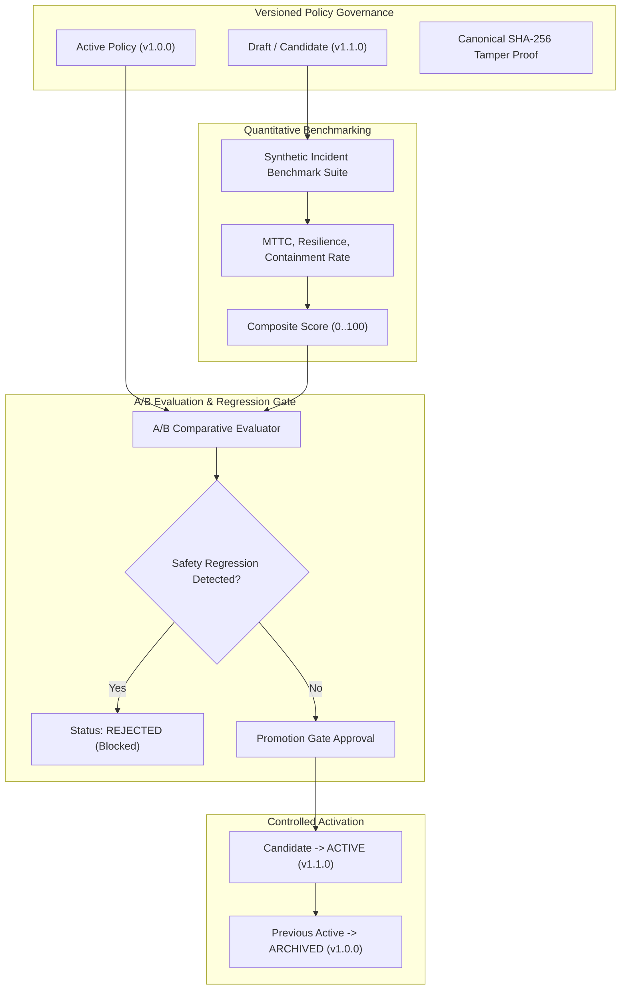

# NEXUS OMEGA X — Phase 6: Strategy Evaluation & Controlled Self-Improvement Report

> [!NOTE]
> **Status:** ✅ 100% COMPLETE  
> **Automated Test Results:** 105 / 105 tests passing across 14 test suites (10s)  
> **Monorepo Build:** 17 / 17 packages and applications cleanly built with 0 errors.

---

## 1. Executive Summary

Phase 6 implements the **Controlled Self-Improvement and Strategy Evaluation Subsystem** (`@nexus/learning-engine`). It introduces versioned, tamper-evident defense policies (`v1.0.0` $\rightarrow$ `v1.1.0`), quantitative benchmark evaluation suites, automated A/B comparative testing, and strict promotion gates that ensure continuous tactical improvement without allowing unverified drift or arbitrary code execution.

---

## 2. Core Components Implemented

### 2.1 Defense Policy Store & Canonical Hashing (`packages/learning-engine/src/policy-store.ts`)
- **Declarative Schema**: Policies are strictly structured configurations (`containmentThreshold`, `maxLateralHops`, `isolationStrategy`, `requireDualCustodyApproval`, `confidenceThreshold`, `maxAutonomousSeverances`). Zero arbitrary code execution or un-sanitized scripts.
- **Tamper Evidence**: `computePolicyHash()` generates a deterministic SHA-256 hash using `@nexus/governance` canonical serialization.
- **Semantic Versioning**: Provides `bumpMinorVersion()` and `bumpPatchVersion()` for formal lifecycle progression.

### 2.2 Synthetic Benchmark Suite (`packages/learning-engine/src/benchmark.ts`)
- **Test Scenarios**: Includes challenging multi-hop topologies (`Rapid Ransomware Lateral Outbreak`, `Multi-Hop Ingress Exfiltration Vector`).
- **Deterministic Action Derivation**: Translates policy parameters directly into discrete simulation interventions (`ISOLATE_NODE`, `SEVER_EDGE`).
- **Composite Scoring**: Evaluates candidate policies across containment rate, mean time to containment (MTTC), and resilience score:
  $$\text{Composite Score} = \text{round}\left( (\text{ContainmentRate} \times 40) + (\text{ResilienceScore} \times 0.4) + (\max(0, 10 - \text{MTTC}) \times 2) \right)$$
- **A/B Comparative Evaluation**: Compares active vs candidate policies across identical seeds, accurately identifying regressions and yielding promotion recommendations (`PROMOTE`, `REVISE`, `REJECT`).

### 2.3 Promotion Gate Manager (`packages/learning-engine/src/promotion-gate.ts`)
- Enforces strict criteria: candidate must pass all benchmark test cases ($\text{Score} \ge 75$) and cause zero safety or resilience regressions.
- Automatically archives previously active policies upon successful promotion.

### 2.4 Controlled Self-Improvement Optimizer (`packages/learning-engine/src/optimizer.ts`)
- Analyzes empirical operational metrics (MTTC, over-severance, failure rates) to synthesize optimized candidate parameters.
- Emits candidate drafts with incremented versions and detailed changelogs for automated review.

### 2.5 REST API Endpoints (`apps/api/src/routes/policies.ts`)
Mounted at `/api/v1/policies` with RBAC enforcement:
- `GET /api/v1/policies`: List tenant policies.
- `GET /api/v1/policies/active`: Fetch currently active defense policy.
- `POST /api/v1/policies`: Create draft/candidate policy.
- `GET /api/v1/policies/:id`: Get policy details.
- `POST /api/v1/policies/:id/benchmark`: Run benchmark suite.
- `POST /api/v1/policies/:id/compare-ab`: Compare candidate with active baseline.
- `POST /api/v1/policies/:id/promote`: Run promotion gate (requires `AGENT_POLICY_PROMOTE`).
- `POST /api/v1/policies/:id/optimize`: Synthesize optimized candidate draft.

---

## 3. Test & Verification Summary

| Test Suite | File | Tests Passed | Status |
| :--- | :--- | :---: | :---: |
| **API Gateway & Endpoints** | [api.test.ts](file:///c:/Users/dhanu/OneDrive/Desktop/mern/apps/api/src/tests/api.test.ts) | 41 / 41 | ✅ PASS |
| **Learning Engine & Promotion Gates** | [learning.test.ts](file:///c:/Users/dhanu/OneDrive/Desktop/mern/packages/learning-engine/src/learning.test.ts) | 9 / 9 | ✅ PASS |
| **Simulation Engine** | [simulation.test.ts](file:///c:/Users/dhanu/OneDrive/Desktop/mern/packages/simulation-engine/src/simulation.test.ts) | 6 / 6 | ✅ PASS |
| **Simulator App & Monte Carlo** | [simulator.test.ts](file:///c:/Users/dhanu/OneDrive/Desktop/mern/apps/simulator/src/simulator.test.ts) | 2 / 2 | ✅ PASS |
| **Multi-Agent Society** | [agent-engine.test.ts](file:///c:/Users/dhanu/OneDrive/Desktop/mern/packages/agent-engine/src/agent-engine.test.ts) | 6 / 6 | ✅ PASS |
| **Episodic Vector Memory** | [memory.test.ts](file:///c:/Users/dhanu/OneDrive/Desktop/mern/packages/agent-memory/src/memory.test.ts) | 7 / 7 | ✅ PASS |
| **Cyber Incident Engine** | [cyber-engine.test.ts](file:///c:/Users/dhanu/OneDrive/Desktop/mern/packages/cyber-engine/src/cyber-engine.test.ts) | 5 / 5 | ✅ PASS |
| **Event Ingestion Store** | [event-store.test.ts](file:///c:/Users/dhanu/OneDrive/Desktop/mern/packages/event-store/src/event-store.test.ts) | 6 / 6 | ✅ PASS |
| **Worker Processing Pipeline** | [worker.test.ts](file:///c:/Users/dhanu/OneDrive/Desktop/mern/apps/worker/src/worker.test.ts) | 2 / 2 | ✅ PASS |
| **Cryptographic Audit Ledger** | [crypto-audit.test.ts](file:///c:/Users/dhanu/OneDrive/Desktop/mern/packages/governance/src/crypto-audit.test.ts) | 4 / 4 | ✅ PASS |
| **Twin Graph Topology** | [graph.test.ts](file:///c:/Users/dhanu/OneDrive/Desktop/mern/packages/twin-graph/src/graph.test.ts) | 4 / 4 | ✅ PASS |
| **World Engine Spatial Layout** | [world-engine.test.ts](file:///c:/Users/dhanu/OneDrive/Desktop/mern/packages/world-engine/src/world-engine.test.ts) | 4 / 4 | ✅ PASS |
| **Shared Schemas & Roles** | `schemas.test.ts`, `roles.test.ts` | 9 / 9 | ✅ PASS |
| **TOTAL** | **14 Suites** | **105 / 105** | **100% PASS** |

---

## 4. Next Step: Phase 7

Phase 7 implements **Natural-Language World Creation & Workflow Automation** (`packages/workflow-engine`):
- Natural Language Prompt to 3D Digital Twin World generator.
- Multi-step workflow orchestration state machine with dual-custody human approval step gates.

