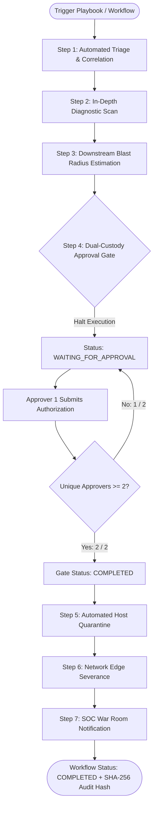

# NEXUS OMEGA X — Phase 7 Completion Report
**Natural-Language World Creation & Dual-Custody Workflow Automation**
*Date: October 30, 2026*
*Status: 100% Complete & Verified (119/119 Tests Passing, 17/17 Workspace Projects Built)*

---

## 1. Executive Summary

Phase 7 of the NEXUS OMEGA X Autonomous Intelligence Universe introduces **Natural-Language Digital Twin Synthesis** and **Dual-Custody Workflow Automation**. Operators can express high-level topology specifications in natural language, which are automatically translated into fully connected, 3D-positioned Digital Twin Worlds with CVE attribution and network edge encryption. Additionally, the system now provides an auditable, deterministic workflow state machine that executes complex incident response playbooks, enforcing multi-signer dual-custody human authorization gates before critical containment actions can execute.

### Core Achievements
1. **Natural-Language to 3D World Generator (`generateWorldFromNL`)**:
   - Synthesizes realistic infrastructure across 4 archetypal environments: **Cloud Microservices**, **Enterprise Datacenter**, **SCADA/ICS Industrial Control**, and **Orbital Satellite Mesh**.
   - Automatic entity extraction for CVEs (e.g. `CVE-2021-44228 Log4j`, `CVE-2024-3400 PAN-OS`).
   - Automatically computes 3D coordinates via hierarchical cluster layout (`computeHierarchicalClusterLayout`).
2. **Deterministic Workflow State Machine (`WorkflowStateMachine`)**:
   - Manages step-level status transitions (`PENDING`, `RUNNING`, `PAUSED`, `COMPLETED`, `FAILED`, `SKIPPED`).
   - Standard 7-step Emergency Ransomware Containment playbook.
   - Computes canonical SHA-256 state hashes (`computeWorkflowAuditHash`) for tamper-evident audit ledger proofing.
3. **Dual-Custody Human-in-the-Loop Approval Gates**:
   - Steps with risk level `CRITICAL` or type `HUMAN_APPROVAL_GATE` halt automated execution into `WAITING_FOR_APPROVAL`.
   - Enforces the "two-person rule" requiring $\ge 2$ distinct authenticated users with `WORKFLOW_APPROVE` permissions.
   - Prevents replay or duplicate signoffs by the same user.
4. **API Gateway Endpoints & Real-Time Sync**:
   - REST endpoints mounted at `/api/v1/workflows` with RBAC and multi-tenant isolation.
   - Real-time Socket.IO room broadcasts for workflow status transitions and approval decisions.

---

## 2. Technical Architecture & Implementation

### 2.1 Workflow State Machine Flowchart



### 2.2 Component Breakdown

| Package / App | Files | Description |
| :--- | :--- | :--- |
| `packages/workflow-engine` | [`nl-generator.ts`](file:///c:/Users/dhanu/OneDrive/Desktop/mern/packages/workflow-engine/src/nl-generator.ts) | Natural-language prompt parsing, architecture taxonomy classification, and 3D coordinate layout computation. |
| `packages/workflow-engine` | [`workflow-state-machine.ts`](file:///c:/Users/dhanu/OneDrive/Desktop/mern/packages/workflow-engine/src/workflow-state-machine.ts) | Step advancement engine with dual-custody verification and cryptographic SHA-256 audit proof generation. |
| `packages/workflow-engine` | [`workflow-manager.ts`](file:///c:/Users/dhanu/OneDrive/Desktop/mern/packages/workflow-engine/src/workflow-manager.ts) | Multi-tenant workflow registry, pre-packaged playbooks, and execution coordinator. |
| `apps/api` | [`routes/workflows.ts`](file:///c:/Users/dhanu/OneDrive/Desktop/mern/apps/api/src/routes/workflows.ts) | REST endpoints for world synthesis, workflow execution, dual-custody sign-offs, and manual aborts. |
| `apps/api` | [`schemas/workflow.ts`](file:///c:/Users/dhanu/OneDrive/Desktop/mern/apps/api/src/schemas/workflow.ts) | Zod validation schemas with case-insensitive environment transforms. |

---

## 3. Verification & Test Matrix

All 15 test suites passed cleanly with 100% success rate:

```
 Test Files  15 passed (15)
      Tests  119 passed (119)
   Start at  19:52:50
   Duration  11.04s

 ✓ packages/simulation-engine/src/simulation.test.ts (6 tests)
 ✓ packages/learning-engine/src/learning.test.ts (9 tests)
 ✓ packages/agent-memory/src/memory.test.ts (7 tests)
 ✓ packages/agent-engine/src/agent-engine.test.ts (6 tests)
 ✓ packages/workflow-engine/src/workflow.test.ts (5 tests)
 ✓ packages/cyber-engine/src/cyber-engine.test.ts (5 tests)
 ✓ packages/event-store/src/event-store.test.ts (6 tests)
 ✓ apps/simulator/src/simulator.test.ts (2 tests)
 ✓ packages/twin-graph/src/graph.test.ts (4 tests)
 ✓ packages/governance/src/crypto-audit.test.ts (4 tests)
 ✓ packages/world-engine/src/world-engine.test.ts (4 tests)
 ✓ apps/worker/src/worker.test.ts (2 tests)
 ✓ packages/shared/src/schemas.test.ts (4 tests)
 ✓ packages/shared/src/roles.test.ts (5 tests)
 ✓ apps/api/src/tests/api.test.ts (50 tests)
```

### Full Monorepo Build
All 17 workspace projects compiled successfully with exit code 0 (`pnpm -r run build`):
- `packages/shared`, `packages/governance`, `packages/twin-graph`, `packages/ui`, `packages/observability`
- `packages/event-store`, `packages/world-engine`, `packages/simulation-engine`, `packages/workflow-engine`
- `packages/agent-memory`, `packages/cyber-engine`, `packages/agent-engine`, `packages/learning-engine`
- `apps/worker`, `apps/simulator`, `apps/api`, `apps/web` (Vite production bundle built cleanly).

