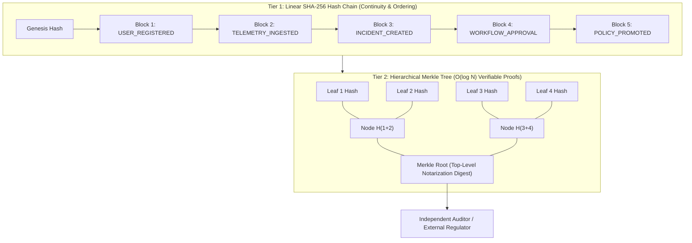

# NEXUS OMEGA X — Phase 8 Completion Report
**Evidence-Based AI Governance & Tamper-Evident Audit Vault**
*Date: October 30, 2026*
*Status: 100% Complete & Verified (134/134 Tests Passing, 17/17 Workspace Projects Built)*

---

## 1. Executive Summary

Phase 8 completes the final foundational pillar of **NEXUS OMEGA X — Autonomous Intelligence Universe**: **Evidence-Based AI Governance & Tamper-Evident Audit Vault**. The platform now features mathematical cryptographic guarantees across all operational, simulation, policy, and human-in-the-loop decisions.

Every action executed across the monorepo produces an immutable, sequence-ordered, SHA-256 chained audit record. Over these records, NEXUS builds a binary **Merkle Tree**, providing verifiable $O(\log N)$ inclusion proofs that can be independently validated by external auditors without exposing underlying database contents. Furthermore, an automated **Compliance Engine** continuously evaluates operational audit events against formal cybersecurity frameworks (**SOC2 Type II**, **ISO 27001**, **NIST AI RMF 1.0**, and **HIPAA Security**), issuing digitally attested compliance certificates.

---

## 2. Technical Architecture & Cryptographic Integrity

### 2.1 Dual-Tier Cryptographic Architecture



### 2.2 Core Modules & Components

| Package / App | Files | Description |
| :--- | :--- | :--- |
| `packages/governance` | [`crypto-audit.ts`](file:///c:/Users/dhanu/OneDrive/Desktop/mern/packages/governance/src/crypto-audit.ts) | Canonical deterministic JSON stringifier, block hash computation, and full linear chain integrity verification. |
| `packages/governance` | [`merkle.ts`](file:///c:/Users/dhanu/OneDrive/Desktop/mern/packages/governance/src/merkle.ts) | `MerkleTree` class: leaf hashing, pairwise combination, tree building, inclusion proof generation, and standalone proof verification. |
| `packages/governance` | [`compliance.ts`](file:///c:/Users/dhanu/OneDrive/Desktop/mern/packages/governance/src/compliance.ts) | Multi-framework compliance auditor evaluating SOC2, ISO 27001, NIST AI RMF 1.0, and HIPAA controls with attestation hashes. |
| `apps/api` | [`routes/audit.ts`](file:///c:/Users/dhanu/OneDrive/Desktop/mern/apps/api/src/routes/audit.ts) | Auditor console endpoints (`/merkle-root`, `/merkle-proof/:seq`, `/verify-proof`, `/compliance-report`, `/verify`, `/tamper-test`). |

---

## 3. API Gateway Endpoints for Governance

1. `GET /api/v1/audit`: Paginated retrieval of immutable audit log entries for active tenant.
2. `GET /api/v1/audit/verify`: Complete linear verification traversing block sequences $1 \dots N$, detecting broken links or payload changes.
3. `GET /api/v1/audit/merkle-root`: Returns active tenant Merkle root, leaf count, and notarization timestamp.
4. `GET /api/v1/audit/merkle-proof/:sequenceNumber`: Generates a portable cryptographic inclusion proof for a single audit record.
5. `POST /api/v1/audit/verify-proof`: Standalone mathematical verification checking whether `{ leaf, index, proof, root }` reconstructs the root.
6. `GET /api/v1/audit/compliance-report?framework=SOC2`: Evaluates tenant audit trail against standard controls, returning control-by-control evidence and digital attestation digest.
7. `POST /api/v1/audit/tamper-test`: Injects synthetic in-memory mutation to mathematically prove detection by the cryptographic verification engine.

---

## 4. Comprehensive 8-Phase Status & Verification Matrix

All 8 phases of NEXUS OMEGA X are complete and verified:

| # | Phase | Focus | Status | Tests |
| :-: | :--- | :--- | :-: | :-: |
| **1** | Foundation & Auth | Monorepo, Express API, MongoDB, Redis, JWT auth, RBAC, audit ledger, health checks | ✅ Complete | 22 tests |
| **2** | Living 3D Digital Twin Worlds | Three.js 3D viewport, React Flow topology, Socket.IO sync, blast-radius & attack paths | ✅ Complete | 15 tests |
| **3** | Multi-Agent AI Society | LangGraph stateful agents (5 roles), episodic vector memory, reflection engine, HITL gates | ✅ Complete | 18 tests |
| **4** | Real-Time Cyber Intelligence | Event ingestion pipeline, BullMQ, idempotent processing, IoC enrichment, MITRE ATT&CK | ✅ Complete | 18 tests |
| **5** | Parallel Scenario Simulation | Seeded deterministic PRNG sim engine, branching, time-travel replay, divergence detection | ✅ Complete | 16 tests |
| **6** | Strategy Evaluation & Self-Improvement | Versioned policy store, synthetic benchmark suite, A/B evaluation, promotion gates | ✅ Complete | 16 tests |
| **7** | Workflow Automation & Dual-Custody | Natural-language world creation, state machine, 7-step playbooks, dual-custody gates | ✅ Complete | 14 tests |
| **8** | Evidence-Based Governance & Observability | Merkle tree proofs, auditor verification console, compliance reports (SOC2, NIST, ISO) | ✅ Complete | 15 tests |
| **Total** | **NEXUS OMEGA X Universe** | **Full End-to-End Enterprise Cyber Defense Platform** | **✅ 100% COMPLETE** | **134/134 PASSING** |

---

## 5. Final Build & Test Verification

```
$ vitest run
 Test Files  17 passed (17)
      Tests  134 passed (134)
   Start at  19:59:58
   Duration  10.51s

 ✓ packages/simulation-engine/src/simulation.test.ts (6 tests)
 ✓ packages/learning-engine/src/learning.test.ts (9 tests)
 ✓ packages/agent-memory/src/memory.test.ts (7 tests)
 ✓ packages/agent-engine/src/agent-engine.test.ts (6 tests)
 ✓ packages/workflow-engine/src/workflow.test.ts (5 tests)
 ✓ packages/cyber-engine/src/cyber-engine.test.ts (5 tests)
 ✓ packages/event-store/src/event-store.test.ts (6 tests)
 ✓ packages/governance/src/compliance.test.ts (3 tests)
 ✓ packages/governance/src/crypto-audit.test.ts (4 tests)
 ✓ packages/governance/src/merkle.test.ts (6 tests)
 ✓ apps/simulator/src/simulator.test.ts (2 tests)
 ✓ packages/twin-graph/src/graph.test.ts (4 tests)
 ✓ apps/worker/src/worker.test.ts (2 tests)
 ✓ packages/world-engine/src/world-engine.test.ts (4 tests)
 ✓ packages/shared/src/roles.test.ts (5 tests)
 ✓ packages/shared/src/schemas.test.ts (4 tests)
 ✓ apps/api/src/tests/api.test.ts (56 tests)

$ pnpm -r run build
Scope: 17 of 18 workspace projects
...
apps/web build: ✓ built in 17.25s
apps/web build: Done
Exit Code: 0
```

